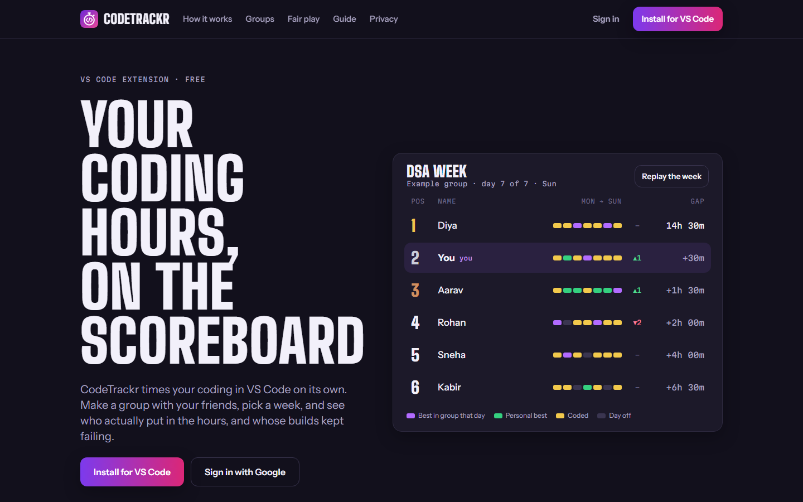
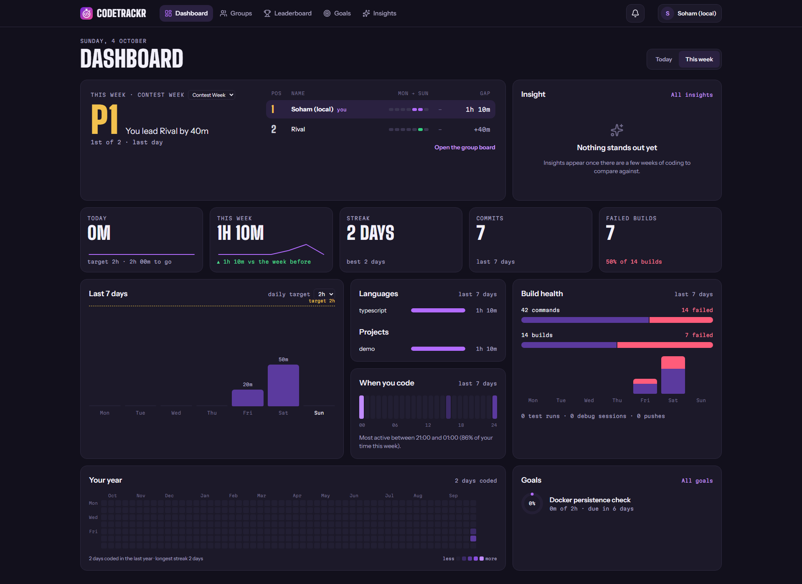
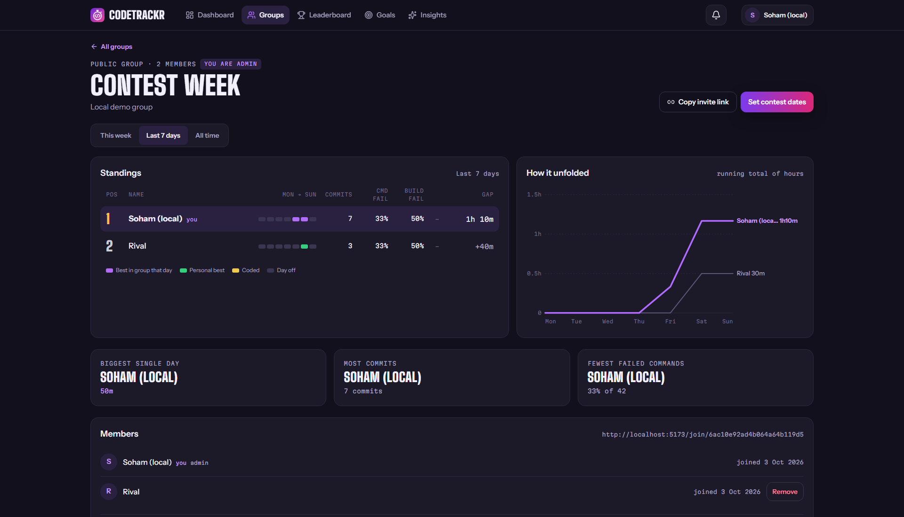
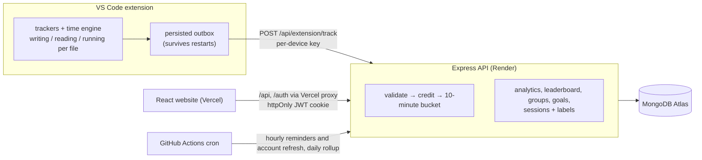

# CodeTrackr

**Your coding hours, on the scoreboard.** A VS Code extension tracks your coding time on its own,
and a website turns it into a dashboard, goals, a global leaderboard and groups where friends race
each other week by week.

[](https://github.com/PratikJambhule/CodeTrackr/actions/workflows/ci.yml)
[](https://marketplace.visualstudio.com/items?itemName=CodeTrackr-ext.codetrackr-vscode)

- **Website:** https://code-trackr-frontend.vercel.app
- **Extension:** [CodeTrackr for VS Code](https://marketplace.visualstudio.com/items?itemName=CodeTrackr-ext.codetrackr-vscode)
- **1-minute demo video:** https://code-trackr-frontend.vercel.app/#demo



## Features

- **Accurate time.** Extension 2.6.0 counts time from your actions, second by second: writing,
  reading, and running (a build or program you wait on), per file. A pause over 60 s counts nothing.
  Summaries carry counts and file names, never file contents, diffs, paths or command text.
- **Weekly race.** Every group has a board: an F1-style standings tower (one cell per day, gap to the
  leader), a race chart of running totals, highlights, and contest dates you can share as a link.
- **Dashboard.** Your race, today and this week, how you spent it (writing / reading / running and
  your top files), the week by kind of work, a year heatmap, languages and projects, when you code,
  build health (commands by kind with failures, program runs, real debugging), goals and the top
  insight.
- **Hackathons.** Create an event with a start, an end, a team size and an editor rule (any editor, or VS Code required), and share its link. People make or join teams there. While it runs, every team sees its GitHub pushes and VS Code time inside the event; it shows activity, not the quality of a project. The organiser can refresh GitHub on demand and sees plain checks: who has no verified GitHub account, who hasn't connected VS Code, quiet teams, and pushes with no VS Code time.
- **Weekly group board.** Members with a verified account are ranked by problems solved this week on LeetCode and Codeforces, with contests entered and GitHub pushes next to it. Plain counts from those sites. VS Code time is shown separately and doesn't affect the rank.
- **Group roles and invites.** Owner, admins and members; hand over ownership; invite links that expire, run out and can be revoked (only a hash is stored); an activity log of admin actions.
- **Leaderboard.** Everyone ranked by hours, all time or the last 7 / 30 days.
- **Goals.** "N hours of X by a date", with progress from matching time and one reminder per goal.
- **Insights.** Plain statistics over your own data (deep-work ratio, peak hours, cadence, rework)
  and 13 threshold rules. Every number shows "—" until there is enough data. Not machine learning.
- **What kind of work.** Each coding session is shown as DSA, Project work or Learning & setup, with a
  one-tap ✓ / Change. You can also pick the kind in VS Code's status bar. Your answers are private.
- **Analytics per kind of work.** Insights has a tab for each kind, because each cares about
  different things:
  - **DSA:** problems worked on and time on each, compile-and-run loops, failed compiles, days
    practised.
  - **Project work:** time per project, commits, files, debugging time and breakpoint stops,
    failed builds and tests.
  - **Learning & setup:** reading and docs time, repos explored, installs that failed, config files,
    and a warning when setup takes a quarter of your coding time.

  Each tab says how many sessions you confirmed; the rest are CodeTrackr's guess.
- **LeetCode and Codeforces on your profile.** Link a LeetCode username and a Codeforces handle to
  see problems solved by difficulty and topic, recent solves, contest rating (and on Codeforces your
  rank, best rating and rating over recent contests), refreshed every hour. Shown only to you, never
  on boards; unlinking deletes it.
- **GitHub.** Link and verify a GitHub username to see your public pushes, active days, merged pull requests and most active repos, refreshed every hour. Public activity only; counts and times are stored, never code.
- **Practice analytics.** One page over both sites: problems solved per topic (the two sites' topic
  names mapped to one list), interview topics with little practice, Codeforces acceptance rate per
  topic, problems solved per week, how hard you practise (the share of solves above your rating,
  and the hardest and average problem per month), contest ratings, and your VS Code DSA time.
- **Rating outlook (machine learning).** On the Practice page, a range for your Codeforces rating in
  12 weeks from three gradient-boosting models trained on ~37,000 Codeforces users; on 7,474 people
  it never saw, 79.8% of real outcomes fell inside the range. The trees run in Node, no Python server.
- **Practice on boards.** Verify a linked account (a short code in your public LeetCode "About" or
  Codeforces name) and your groups' boards and the leaderboard ("Problems solved") show your problems
  solved this week and ratings. Unverified accounts stay private, so nobody can borrow a profile.
- **One-click sign-in for VS Code.** *CodeTrackr: Sign In* shows a code; approve it on the website
  and that computer gets its own revocable key, stored in the OS keychain.





## How it works



- **Credited, not trusted, time.** An upload counts only as far as window-focus time (or a program
  that is really running) vouches for it, capped at 600 s per user per 10-minute window with an
  atomic counter, so a script cannot farm hours. A write that fails gives its claimed seconds back,
  so a retried upload is still credited.
- **Ten-minute buckets.** Uploads are merged with one atomic `$inc` upsert per (user, project,
  language, 10 minutes): about 5× fewer documents and 13× less data than one document per upload
  (local benchmark at the 2-minute upload cadence).
- **Idempotent uploads.** Each upload carries an id; a retry after a dropped connection is applied once.
- **Running totals.** The all-time leaderboard reads one stats row per user instead of scanning all
  activity: 6.7 s → 62 ms at 1M rows in a local benchmark (`backend/bench/`).
- **One site for the browser.** Vercel forwards `/api` and `/auth` to the API, so the login cookie is
  first-party, which browsers that block third-party cookies (Safari, private windows) require.

## Tech stack

| Layer | Stack |
|---|---|
| Extension | TypeScript, esbuild, VS Code API (shell integration, Git API, SecretStorage) |
| Backend | Node.js, Express 5, Mongoose 8, Passport (Google OAuth 2.0), JWT cookie, helmet, express-rate-limit |
| Database | MongoDB Atlas |
| Frontend | React 19, Vite 7, TypeScript, Tailwind CSS (dark + light design tokens), React Router 7, TanStack Query 5, hand-made SVG charts |
| Testing | `node:assert` unit tests, supertest + mongodb-memory-server integration tests, Vitest + Testing Library |
| Hosting & CI | Render (API), Vercel (website), GitHub Actions (CI, scheduled jobs), Docker |

## Getting started

### Run everything with Docker

Needs Docker Desktop (running). From the project folder:

```bash
docker compose up --build
```

Open http://localhost:5173. This starts MongoDB 7, the API (seeded with demo data) and the website
with live reload. You are signed in as a demo user; Google sign-in is replaced by a local-only
bypass that the API refuses in production. Stop with `Ctrl+C`; `docker compose down -v` also deletes
the local data.

### Run without Docker or any accounts

Needs Node.js 22.12 or newer (24 recommended).

```bash
cd backend && npm install && npm run dev:local
```

```bash
cd frontend && npm install && npm run dev
```

The API runs on an in-memory MongoDB with demo data for every page (about ten months of activity,
friends, groups, goals). Data is gone when the process stops. To run it next to Docker, use
`DEV_PORT=5051 node scripts/dev-local.js` and `VITE_API_URL=http://localhost:5051 npx vite --port 5174`.

### Run against your own MongoDB and Google sign-in

```bash
cd backend && cp .env.example .env
```

Fill in `MONGO_URI`, `JWT_SECRET`, `GOOGLE_CLIENT_ID`, `GOOGLE_CLIENT_SECRET` and
`GOOGLE_CALLBACK_URL` (`http://localhost:5050/auth/google/callback`), then `npm run dev` in
`backend/` and `npm run dev` in `frontend/`. LeetCode and Codeforces linking need no key.

### Try the extension locally

```bash
cd extension && npm install && npm run build
```

```bash
code --new-window --user-data-dir ./.vscode-test-profile --extensions-dir ./.vscode-test-ext --extensionDevelopmentPath "$(pwd)/extension" path/to/any/folder
```

In that window set `codetrackr.apiBase` to `http://localhost:5050` and run **CodeTrackr: Sign In**.

## Tests

```bash
cd backend && npm test && npm run test:int
```

```bash
cd extension && npm test
```

```bash
cd frontend && npm run lint && npm test && npm run build
```

570 backend unit assertions, 80 API integration tests (the real Express app over HTTP against an
in-memory MongoDB), 135 extension assertions and 79 frontend tests. Frontend tests run in the India
time zone, where the date bugs showed up. CI runs all of them, plus a Docker build with a health
check, on every push.


## Project structure

```
backend/     Express API: routes/, services/, models/, middleware/, tests/, scripts/, bench/
frontend/    React website: src/pages, src/components (ui, charts, layout), src/lib, src/hooks
extension/   VS Code extension: src/ (trackers, outbox, sign-in), tests/
ml/          rating forecast: data conversion, training scripts
.github/     CI, scheduled jobs, deploy workflow
```

## Privacy

The extension sends counts and durations, the language, the project (folder) name, the names of the
files you worked in (never folders or full paths), and terminal commands by kind (install, run,
compile, build, test, git, docker, other) with whether they failed.
Command text is never stored: extension 2.6.0 sends only the kind, and the server reduces any text an
older extension sends to its kind before saving. File contents, diffs and full paths are never sent.
If you link LeetCode or Codeforces, the server reads only your public profile there (solved
problems by difficulty and topic, ratings), shows it only to you, and deletes it when you unlink.
The website's privacy page explains it in full.

## Team

Pratik Jambhule, Kartik Kharat, Soham Budhewar. The extension is MIT-licensed (`extension/LICENSE`).
